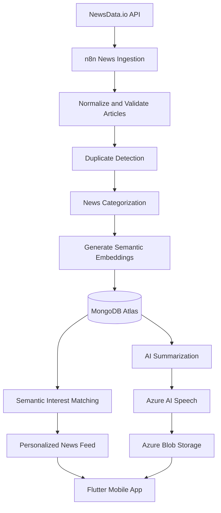

# MADAR-GP | مدار 📰

### AI-Powered Personalized Arabic News Platform

Madar (مدار) is an AI-powered Arabic news platform developed as a software engineering graduation project. It aims to transform the way users discover and consume news by delivering personalized content based on their interests.

By combining semantic embeddings, AI-powered summarization, automated news processing, and Arabic text-to-speech, Madar helps users discover relevant articles, understand key information efficiently, and listen to news on the go.

## ✨ Features

- **Personalized News Feed:** Matches news articles with users' interests using semantic embeddings.
- **AI-Powered Summarization:** Generates concise summaries of Arabic news articles.
- **Arabic Text-to-Speech:** Converts news articles and summaries into audio using Azure AI Speech.
- **Automated News Ingestion:** Collects, processes, and categorizes Arabic news through automated n8n workflows.
- **Semantic Matching:** Uses embeddings to identify articles relevant to users' interests.
- **Interest-Based Notifications:** Supports personalized news discovery based on user preferences.
- **News Categorization:** Organizes content into Health, Entertainment, Politics, Technology, Sports, and Economy.
- **Cloud Audio Storage:** Stores generated audio files in Azure Blob Storage and references them through URLs.
- **Mobile Application:** Provides a mobile experience built with Flutter and Dart.

## 🛠️ Technology Stack

| Component | Technologies |
|---|---|
| Mobile Application | Flutter, Dart |
| Backend | NestJS, Node.js |
| Database | MongoDB Atlas |
| AI Integration | OpenAI APIs |
| Workflow Automation | n8n |
| News Data Source | NewsData.io API |
| Text-to-Speech | Azure AI Speech |
| Cloud Storage | Azure Blob Storage |
| Authentication | JWT-based authentication |

## 🏗️ System Architecture

Madar integrates a mobile application, backend services, automated workflows, AI processing, and cloud storage to deliver personalized Arabic news.

### Architecture Overview



### News Processing Pipeline

1. **News Collection:** Scheduled n8n workflows retrieve Arabic news articles from NewsData.io.
2. **Data Normalization:** Incoming articles are processed into a consistent format.
3. **Duplicate Detection:** Existing articles are checked to reduce duplicate content.
4. **Categorization:** Articles are assigned to relevant news categories.
5. **Embedding Generation:** Eligible articles are converted into semantic embeddings.
6. **Data Storage:** Article content, summaries, metadata, and embedding data are stored in MongoDB Atlas.
7. **Personalization:** Semantic matching identifies articles related to users' interests.
8. **Audio Generation:** Azure AI Speech generates audio for news content and summaries.
9. **Cloud Storage:** Generated audio files are stored in Azure Blob Storage, with their URLs saved in MongoDB Atlas.
10. **Mobile Delivery:** The Flutter application presents personalized news and provides access to available summaries and audio.

## 📱 Mobile Application

The Madar mobile application is developed using Flutter and Dart.

It provides the user-facing experience for discovering personalized Arabic news, exploring different categories, managing interests, and accessing AI-generated summaries and audio content.

## 🗄️ Database and Storage

### MongoDB Atlas

MongoDB Atlas stores application data, including:

- News articles and metadata
- Article categories
- AI-generated summaries
- Semantic embeddings
- Audio file URLs
- User-related information and preferences

### Azure Blob Storage

Azure Blob Storage stores audio files generated through Azure AI Speech. MongoDB Atlas retains the corresponding URLs so the application can retrieve the audio when needed.

## 🤖 AI and Personalization

Madar uses AI technologies to improve news discovery and accessibility.

### Semantic Personalization

Semantic embeddings represent the meaning of news articles and user interests. By comparing their semantic representations, Madar can identify relevant content beyond simple keyword matching.

### AI-Powered Summarization

AI-generated summaries provide a concise overview of news articles, helping users understand important information without reading every article in full.

### Arabic Text-to-Speech

Azure AI Speech converts news articles and summaries into audio, supporting users who prefer listening to news.

## ⚙️ Workflow Automation

Madar uses n8n to automate news ingestion and processing tasks.

The workflows coordinate scheduled data collection, article normalization, duplicate detection, categorization, embedding generation, database storage, and subsequent personalization processes.

This automation reduces repetitive manual work and supports a consistent news-processing pipeline.

## 🚀 Getting Started

The following instructions provide a general development setup. Exact commands depend on the repository's directory structure and configuration.

### Prerequisites

Install or configure the following:

- [Flutter SDK](https://docs.flutter.dev/get-started/install)
- [Dart SDK](https://dart.dev/get-dart)
- [Node.js](https://nodejs.org/)
- npm
- [MongoDB Atlas](https://www.mongodb.com/atlas)
- [n8n](https://n8n.io/)
- OpenAI API access
- NewsData.io API access
- Azure AI Speech and Azure Blob Storage credentials

### 1. Clone the Repository

```bash
git clone https://github.com/shmuhaisin/MADAR-GP.git
cd MADAR-GP
```

### 2. Locate the Application and Backend

The repository contains a `Project` directory. Navigate into it and identify the Flutter application and NestJS backend directories.

```bash
cd Project
```

Run the following commands from the appropriate directories, rather than assuming both applications are located at the repository root.

### 3. Set Up the Flutter Application

Navigate to the Flutter project directory:

```bash
flutter pub get
flutter run
```

Ensure that a supported emulator, simulator, or physical device is available.

### 4. Set Up the NestJS Backend

Navigate to the backend directory:

```bash
npm install
npm run start:dev
```

Configure the required environment variables before starting the backend.

### 5. Configure n8n

Import or recreate the project's news ingestion workflows in your n8n instance.

Configure the required credentials and connections for:

- NewsData.io
- MongoDB Atlas
- AI embedding and summarization services
- Any additional services used by the workflows

Verify that the workflows execute successfully before relying on the personalized news feed.

## 🔐 Environment Variables

Create local environment files according to the requirements of the Flutter application, backend, and n8n workflows.

The following names are illustrative. Use the exact names expected by your implementation.

```env
# Database
MONGODB_URI=

# Authentication
JWT_SECRET=

# News Source
NEWSDATA_API_KEY=

# AI Services
OPENAI_API_KEY=

# Azure AI Speech
AZURE_SPEECH_KEY=
AZURE_SPEECH_REGION=

# Azure Blob Storage
AZURE_STORAGE_CONNECTION_STRING=
```

**Security guidelines:**

- Never commit `.env` files containing secrets.
- Keep private API keys on the server or in the appropriate secret-management system.
- Do not expose database credentials or Azure connection strings in the mobile application.
- Use restricted credentials and appropriate access controls for production deployments.

## 🧪 Testing and Validation

Before running the application in a production environment, verify the following:

- Backend connectivity to MongoDB Atlas
- User authentication and authorization
- Successful news ingestion and duplicate detection
- Correct article categorization
- Embedding generation and semantic matching
- Summary generation
- Audio generation and retrieval
- Flutter-to-backend API communication
- Error handling for unavailable external services

## 🎯 Project Objectives

Madar aims to improve the Arabic news consumption experience by reducing information overload and helping users discover content relevant to their interests.

The project brings together mobile development, backend engineering, AI integration, semantic search, workflow automation, and cloud services to create a personalized and accessible news experience.

## 👩‍💻 Project Scope

Madar combines several areas of software engineering:

- Cross-platform mobile development
- REST API and backend development
- Database design and data management
- AI integration and semantic search
- Automated data processing
- Cloud-based audio generation and storage
- Personalized content delivery

## 📌 Project Status

Madar is a software engineering graduation project. The availability of individual features and integrations depends on the current implementation and configuration of external services.

## 📄 License

No license has been specified for this repository. Add a license file if you intend to distribute the project under specific terms.

---

**Madar (مدار) — News that revolves around your interests.**
